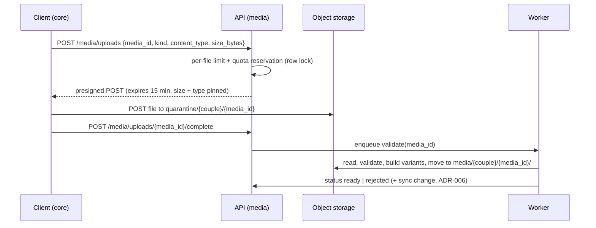

# ADR-007 — Media storage

Implements: DEC-009, DEC-010, DEC-020, REQ-N-SEC-06, REQ-N-PERF-05, REQ-F-MEM-08/09/10, REQ-F-SONG-05,
REQ-F-SYNC-07, REQ-F-ACC-01, REQ-F-ADM-05, REQ-N-LEG-01.
Builds on: C4-001 rule 3 (bytes bypass the API), ADR-005 (Actor), ADR-006 §6 (op waits for its upload).

## Context

Photos, videos, audio and avatars live in private S3-compatible storage (MinIO locally). The frozen rules: short
signed URLs, **real** MIME/size/quota validation, thumbnails, device cache, separate upload queue with retries,
quotas 5 GB per couple and 20/200/30 MB per photo/video/audio file. Open: who owns files, the exact upload flow,
how "real MIME" is checked, how URLs expire without breaking offline viewing, and external sources.

## Decision drivers

1. The API never streams bytes (latency, statelessness).
2. Nothing unvalidated is ever served.
3. Quota cannot be exceeded by two parallel uploads.
4. Offline viewing survives URL expiry.
5. Few dependencies.

## Decision

### 1. New module `media` (amends ADR-001 §1)

`media` owns `MediaAsset` (id, couple, owner, kind, status, sizes, variants) and the couple's storage counter.
`memories` (photo, video, song audio) and `identity` (avatar) reference a `MediaId` only — no foreign key,
per REQ-N-ARC-05. Reason: quota is **per couple across all files**, so one module must own the accounting.

### 2. Upload flow (three steps, client talks to storage directly)

- **Presigned POST** (not PUT) because its policy lets storage itself enforce `content-length-range` and the
  exact `Content-Type`: an oversize file is refused by S3/MinIO before it lands.
- Single-part upload in v1 (max 200 MB). Multipart/resumable upload is the documented seam if mobile video
  uploads prove unreliable.
- The memory/avatar op that references the file stays in the outbox until `complete` succeeds (ADR-006 §6).

### 3. Validation in the worker ("real MIME")

| Kind | Accepted | How it is verified | Variants |
|------|----------|--------------------|----------|
| Photo | JPEG, PNG, WebP | Decoded with **Pillow** (a file that does not decode is rejected) | `thumb_400.webp`, `display_1600.webp`, EXIF stripped (GPS!) |
| Video | MP4, MOV | **ffprobe** parses the container and streams | `poster_800.webp` (first frame); no transcoding |
| Audio | MP3, M4A | **ffprobe** | none |
| Avatar | JPEG, PNG, WebP | Pillow | `avatar_256.webp` |

The declared `content_type` must match what was decoded. Mismatch, decode failure or size drift → object
deleted, reservation released, status `rejected`, reason shown on the device (REQ-F-SYNC-10).
The original is kept untouched (private to the couple); clients display variants by default.

HEIC photos: the mobile app converts to JPEG before upload (Expo image tooling), so the server needs no HEIC
decoder.

### 4. Quota (REQ-F-ADM-05, DEC-020)

`media_storage` row per couple: `used_bytes`, `reserved_bytes`, limit from backoffice settings.

| Moment | Effect (under `SELECT … FOR UPDATE`) |
|--------|--------------------------------------|
| Upload start | reject if `used + reserved + size > limit`; else `reserved += size` |
| Ready | `reserved -= size`; `used += original + variants` |
| Rejected / reservation older than 1 h | `reserved -= size` |
| Entity deleted | object deletion job after commit; `used -= bytes` |

The row lock makes two parallel uploads unable to overshoot (driver 3).

### 5. Reading and offline cache

- Sync records carry `media_id` + variant names, **never URLs** (they would expire inside the local store).
- Client asks `POST /media/urls {ids, variant}` → signed GET URLs valid **10 min**, batched (no N+1).
- Device cache key = `media_id + variant`. Content behind a `media_id` is **immutable** (replacing a photo
  creates a new `MediaAsset`), so a cached file never goes stale and offline viewing works (driver 4).

### 6. External sources (no bytes stored)

| Source | Stored as | Served by | Notes |
|--------|-----------|-----------|-------|
| Photo/video by external URL (REQ-F-MEM-08) | `https` URL | Client loads directly | Not counted in quota; third-party host sees the viewer's IP; not guaranteed offline |
| Direct audio URL | `https` URL | Client background audio | Same notes |
| Spotify | provider + **track/playlist ID** (parsed server-side from the URL) | Visible embed | REQ-N-LEG-01 |
| YouTube | provider + **video ID** | Visible embed via `youtube-nocookie.com` | REQ-N-LEG-01 |

`SongSource` is a discriminated union (`upload | audio_url | spotify | youtube`); a new provider = a new variant
plus one client embed adapter (REQ-F-SONG-05). Raw embed HTML is never stored.

CSP consequence (ADR on security headers): `frame-src` lists Spotify and YouTube-nocookie only; external images
force `img-src https:` — accepted, because external URLs are a frozen requirement.

### 7. Storage layout and access

- One private bucket; no public ACL; server-side encryption on (detail ADR-009).
- Keys: `quarantine/{couple_id}/{media_id}` and `media/{couple_id}/{media_id}/{variant}`.
- Bucket CORS allows only the web origin for `POST` and `GET`.
- Archived couple purge (REQ-F-ADM-03) deletes the `media/{couple_id}/` prefix.

### 8. Dependencies

| Dependency | Why | Alternative rejected |
|------------|-----|----------------------|
| `boto3` (behind `ObjectStorage` port) | S3 API incl. presigned POST; works with MinIO | `django-storages`: wraps boto3 for `FileField`, which our domain never uses |
| `Pillow` | Decode, strip EXIF, WebP variants | `filetype` only sniffs bytes; we need decoding anyway |
| `ffmpeg`/`ffprobe` (system binary in the worker image only) | Probe video/audio, poster frame | Trusting magic bytes alone |

## Consequences

- ✅ Oversize files stopped by storage; unvalidated files never leave quarantine.
- ✅ Offline gallery works indefinitely thanks to immutable media IDs.
- ✅ Quota exact under concurrency.
- ❌ Video served as recorded: an iPhone HEVC `.mov` may not play in every desktop browser. Transcoding is a
  backlog item (CPU-heavy); revisit if it hurts in practice.
- ❌ External URLs leak viewer IPs to third parties and weaken CSP `img-src`.
- ⚠️ The worker image grows with ffmpeg; the API image does not.

## Next step

Camilo approves, rejects, or patches by section number. Then ADR-008 (audit log and partitioning).
