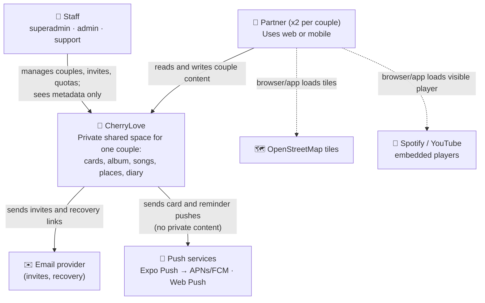
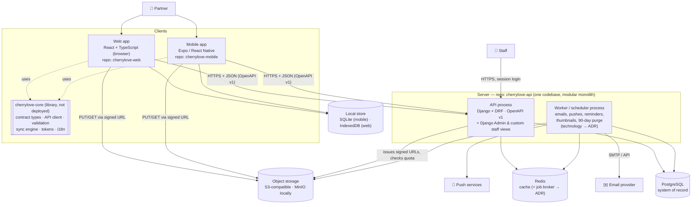

# C4 — Level 1 (context) and level 2 (containers)

Purpose: one picture of who uses CherryLove, which deployable pieces exist, and what they talk to.
Technology choices shown here are only those already fixed by a DEC/REQ; everything else is marked
"→ ADR" and decided in its own record.

Implements: REQ-N-ARC-10 (C4 + ADRs), REQ-N-ARC-03/04 (contract is the only coupling), REQ-N-ARC-07.

## Level 1 — System context

| Actor / system | Role | Source |
|----------------|------|--------|
| Partner | Couple member; sees all shared content, edits own only. | REQ-F-AUTH-05, roles-actuators |
| Staff | Runs the platform; never sees content. | DEC-015, DEC-016 |
| Email provider | Delivers invites (72 h) and recovery links. Local: mail catcher. Production vendor → ADR (OPS). | REQ-F-AUTH-01/08, REQ-N-OPS-01 |
| Push services | Expo Push for mobile, browser Web Push for web. Payloads carry no private content. | REQ-F-NOTIF-03/05 |
| OpenStreetMap | Map tiles, loaded by the client. | DEC-013 |
| Spotify / YouTube | Visible embeds loaded by the client; never background audio. | DEC-010, REQ-N-LEG-01 |

Dashed arrows: the client calls the provider directly; the API is not in the path.

## Level 2 — Containers

### Containers

| Container | Responsibility | Fixed by | Open → ADR |
|-----------|----------------|----------|------------|
| Web app | UI for partners in the browser. No business rule lives only here. | DEC-003, REQ-N-ARC-07 | folder structure, routing, state |
| Mobile app | Same features natively; secure storage for refresh token. | DEC-003, DEC-022, REQ-N-SEC-03 | folder structure, navigation |
| `cherrylove-core` | Shared TS package: generated contract types, API client, validation, sync engine, tokens, i18n. Published to GitHub Packages (SemVer). | DEC-003, DEC-004, REQ-F-SYNC-09 | package layout, codegen tool |
| Local store | Offline reads and the mutation queue. | REQ-F-SYNC-01/02/09 | schema, migration strategy |
| API process | Inbound HTTP adapters (DRF views), use cases, domain, repositories. Also serves Django Admin + custom staff views (same deployable, separate entry point and auth). | DEC-002, DEC-005, DEC-029 | module boundaries, auth, errors |
| Worker / scheduler | Everything that must not block a request or runs on a clock: invites/recovery email, card-published push, anniversary/birthday reminders, thumbnails, archive purge after 90 days. | REQ-F-NOTIF-*, REQ-F-ADM-03, REQ-N-PERF-05 | job library, scheduling |
| PostgreSQL | System of record; constraints enforce REQ-F-AUTH-05. | REQ-N-ARC-08 | ERD, partitioning (REQ-F-LOG-04) |
| Redis | Cache for today's card and home dashboard. | REQ-N-PERF-04 | whether it is also the job broker |
| Object storage | Uploaded photos, videos, audio. Private; access only via short-lived signed URLs. | DEC-009, REQ-N-SEC-06 | upload flow, key layout |

### Rules this diagram encodes

1. **The OpenAPI contract is the only line between clients and server** (REQ-N-ARC-03/04). `cherrylove-core`
   is generated from it; web and mobile never import each other.
2. **One server codebase, two processes.** API and worker share the domain and use cases; only the
   inbound adapter differs (HTTP vs job). This is still one modular monolith (DEC-002), not microservices.
3. **Media bytes bypass the API.** The API authorizes and signs; the client transfers directly to object
   storage. Keeps request latency inside REQ-N-PERF-01 and the API stateless.
4. **Staff and partners share the API process but not the auth path.** Staff use Django sessions in the
   admin; partners use JWT (REQ-N-SEC-03). Detail → auth ADR.
5. **No production hosting is implied.** Local = Docker Compose with every store above plus a mail catcher
   (REQ-N-OPS-01). Production target → later ADR (DEC-022, REQ-N-OPS-02).

## Next step

Camilo approves or patches this document. Then ADR-001 (modular monolith and dependency rules).
