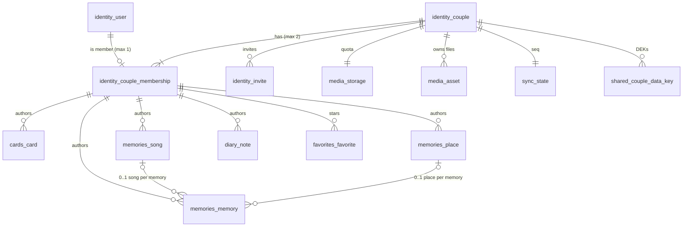

# DATA-001 — Data model (ERD, indexes, constraints)

Implements: REQ-F-AUTH-05 (in the database), REQ-N-ARC-05, REQ-N-ARC-08, REQ-N-PERF-03, REQ-N-SEC-01/05,
REQ-F-SONG-07, REQ-F-PLACE-05, REQ-F-NOTE-02, REQ-F-SYNC-03/05.
Builds on: ADR-001 (modules), ADR-005 (tenancy), ADR-006 (sync columns), ADR-007 (media), ADR-008 (audit),
ADR-009 (`_enc` columns), ADR-013 (jobs).

## Purpose

The server-side PostgreSQL schema, module by module, with the constraints that make the rules impossible to break
**even if application code has a bug**. Column types are PostgreSQL types; Django model code follows in plan F.

## Conventions

| Rule | Detail |
|------|--------|
| Table names | `<module>_<entity>` (Django app label prefix) |
| IDs | `uuid` (v7). Client-generated for syncable entities (REQ-F-SYNC-03), server-generated otherwise |
| Time | `timestamptz` (UTC); civil dates are `date` (DEC-024) |
| Syncable entity columns | `version int not null default 1`, `created_at`, `updated_at`, `deleted_at timestamptz null` (tombstone) |
| Encrypted columns | suffix `_enc`, type `bytea` (ADR-009 §2) |
| Enums | `text` + `CHECK (col IN (...))` — easier to evolve than PostgreSQL `ENUM` types |
| Cross-module references | `uuid` value only, no FK (REQ-N-ARC-05) — except to `Couple`, `User` and the couple–user membership |

## 1. The key idea: tenancy enforced by composite foreign keys

Every couple-owned row stores `couple_id` **and** its `author_id`, and references the membership row with a
**composite FK** `(couple_id, author_id) → identity_couple_membership (couple_id, user_id)`.

Result: PostgreSQL itself refuses a row whose author does not belong to that couple. Linked rows inside a module
use the same trick — `(couple_id, place_id) → memories_place (couple_id, id)` — so a memory can never point to
another couple's place. This is ADR-005's defense in depth, one layer deeper than the ORM.

> Interpretation to approve: REQ-N-ARC-05 allows FKs to `Couple` and `User`; the membership table is the
> couple–user relation itself, so FKs to it are treated as allowed.

## 2. ERD (core entities)

`media_asset`, `favorites_favorite.item_id` and `memory.media_id` / `song.media_id` / `user.avatar_media_id` are
**value references** (no FK) across modules, per REQ-N-ARC-05.

## 3. `identity`

### `identity_user`
| Column | Type | Constraint |
|--------|------|------------|
| `id` | uuid | PK |
| `email` | text | unique index on `lower(email)` |
| `password` | text | Django hash (Argon2, ADR-004) |
| `name` | text | not null, 1–80 chars |
| `birth_date` | date | null until onboarding |
| `language` | text | `CHECK IN ('es','en')`, default `'es'` |
| `avatar_media_id` | uuid | null; value ref to `media_asset` |
| `is_active`, `is_staff`, `is_superuser` | bool | |
| `version`, `created_at`, `updated_at`, `last_login` | | |

### `identity_couple`
| Column | Type | Constraint |
|--------|------|------------|
| `id` | uuid | PK |
| `relationship_start` | date | null until the first partner sets it (REQ-F-AUTH-04) |
| `timezone` | text | not null, default `'America/Bogota'` (REQ-F-CARD-04) |
| `status` | text | `CHECK IN ('active','archived')` |
| `archived_at`, `purge_after` | timestamptz, date | `CHECK (status = 'archived') = (archived_at IS NOT NULL)` |
| `version`, `created_at`, `updated_at` | | |

### `identity_couple_membership` — REQ-F-AUTH-05 lives here
| Column | Type | Constraint |
|--------|------|------------|
| `couple_id` | uuid | FK → `identity_couple`, not null |
| `user_id` | uuid | FK → `identity_user`, not null, **`UNIQUE (user_id)`** → one couple per user |
| `slot` | smallint | **`CHECK (slot IN (1, 2))`** + **`UNIQUE (couple_id, slot)`** → max two per couple |
| `joined_at` | timestamptz | |

Also `UNIQUE (couple_id, user_id)` (target of the composite FKs) and PK `(couple_id, slot)`.

| Rule | Mechanism |
|------|-----------|
| Max two users per couple | `slot ∈ {1,2}` + unique `(couple_id, slot)` — purely declarative, no count query |
| One couple per user | unique `user_id` |
| No couple switching | trigger rejects any `UPDATE` of `couple_id` / `user_id`; `DELETE` allowed only to the `maintenance` role (purge, ADR-008 §4) |
| Staff are never partners | trigger rejects inserts for users with `is_staff = true` |

Why not `couple.partner1_id` / `partner2_id`? A user could then sit in `partner1` of one couple and `partner2` of
another; preventing that needs a trigger across two columns. The membership table makes it a plain unique index.

### `identity_invite`
| Column | Type | Constraint |
|--------|------|------------|
| `id` | uuid | PK |
| `couple_id` | uuid | FK |
| `slot` | smallint | `CHECK IN (1,2)` |
| `email` | text | stored lower-case |
| `token_hash` | bytea | unique (SHA-256 of the token, ADR-004 §4) |
| `status` | text | `CHECK IN ('pending','accepted','revoked','expired')` |
| `expires_at` | timestamptz | `created_at + 72 h` (DEC-017) |
| `created_by` | uuid | FK → staff user |
| `sent_at`, `accepted_at`, `created_at` | timestamptz | |

Partial unique index `(couple_id, slot) WHERE status = 'pending'` → one live invite per seat. REQ-F-AUTH-10 (email
already in a couple) is checked by the use case and, at accept time, guaranteed by `UNIQUE (user_id)` on
membership.

SimpleJWT's outstanding/blacklisted token tables are owned by the library (ADR-004).

## 4. Content modules

All tables below carry the sync columns from *Conventions*, `couple_id`, `author_id` and the composite FK of §1.

### `cards_card`
| Column | Type | Constraint |
|--------|------|------------|
| `body_enc` | bytea | not null |
| `publish_at` | timestamptz | not null |
| `published_at` | timestamptz | null until the publish job runs; `CHECK (published_at IS NULL OR published_at >= publish_at)` |

Indexes: `(couple_id, published_at)` today and random past card; `(couple_id, author_id, publish_at)` "my cards";
partial `(publish_at) WHERE published_at IS NULL AND deleted_at IS NULL` for the publish job.
Published read-only (REQ-F-CARD-07): enforced by the domain; a trigger additionally rejects updates to `body_enc` /
`publish_at` when `published_at IS NOT NULL`.

### `memories_place`
`name text`, `latitude numeric(9,6) CHECK BETWEEN -90 AND 90`, `longitude numeric(9,6) CHECK BETWEEN -180 AND 180`,
`description_enc bytea null`. `UNIQUE (couple_id, id)` (FK target). Index `(couple_id) WHERE deleted_at IS NULL`.

### `memories_song`
| Column | Type | Constraint |
|--------|------|------------|
| `source_type` | text | `CHECK IN ('upload','audio_url','spotify','youtube')` |
| `media_id` | uuid | required iff `upload` |
| `url` | text | required iff `audio_url`; `https://` only |
| `provider_ref` | text | required iff `spotify` / `youtube` (ADR-007 §6) |
| `note_enc` | bytea | null — the personal note (REQ-F-SONG-02, the "description" of REQ-F-SONG-06) |

One `CHECK` per source type makes illegal combinations unrepresentable. `UNIQUE (couple_id, id)`.

### `memories_memory`
| Column | Type | Constraint |
|--------|------|------------|
| `memory_date` | date | not null (civil date) |
| `media_kind` | text | `CHECK IN ('photo','video')` |
| `media_id` | uuid | null |
| `external_url` | text | null, `https://` only |
| — | | `CHECK ((media_id IS NULL) <> (external_url IS NULL))` → exactly one source (REQ-F-MEM-08) |
| `description_enc` | bytea | null |
| `song_id` | uuid | null; FK `(couple_id, song_id) → memories_song (couple_id, id) ON DELETE SET NULL (song_id)` |
| `place_id` | uuid | null; FK `(couple_id, place_id) → memories_place (couple_id, id) ON DELETE SET NULL (place_id)` |

REQ-F-SONG-07: the **only** link between memory and song is `memory.song_id` — editing from either side updates
the same column. REQ-F-PLACE-05: soft-deleting a place clears `place_id` in the same use case; the FK action covers
the hard purge. `SET NULL (column)` with a column list needs PostgreSQL ≥ 15 (pinned in ADR-016).

Indexes: `(couple_id, memory_date, id)` gallery order (REQ-F-MEM-01, REQ-N-PERF-03); `(couple_id, song_id)`;
`(couple_id, place_id)`; `(couple_id, author_id, updated_at)` management list.

### `diary_note`
`body_enc bytea not null`, `visibility text CHECK IN ('shared','only_me') default 'shared'` (DEC-014).
Index `(couple_id, created_at)`; partial `(couple_id, author_id, created_at) WHERE visibility = 'only_me'`.

### `favorites_favorite`
| Column | Type | Constraint |
|--------|------|------------|
| `user_id` | uuid | composite FK `(couple_id, user_id)` → membership |
| `item_type` | text | `CHECK IN ('memory','song','place','note')` |
| `item_id` | uuid | value ref (cross-module, no FK) |

Partial unique `(user_id, item_type, item_id) WHERE deleted_at IS NULL`. Indexes `(couple_id, created_at)` home
timeline (REQ-F-HOME-02); `(user_id, item_type, created_at)` favorites filter (REQ-F-FAV-02).

## 5. Platform modules

| Table | Key columns | Constraints / indexes | ADR |
|-------|-------------|-----------------------|-----|
| `media_asset` | `id`, `couple_id`, `owner_id`, `kind`, `status`, `declared_content_type`, `declared_size`, `stored_bytes`, `variants jsonb`, `rejection_code` | `kind IN ('photo','video','audio','avatar')`; `status IN ('pending','ready','rejected','deleted')`; index `(couple_id, status)` | 007 |
| `media_storage` | `couple_id` PK/FK, `used_bytes`, `reserved_bytes`, `limit_bytes null` (override) | `CHECK (used_bytes >= 0 AND reserved_bytes >= 0)` | 007 §4 |
| `notifications_device` | `id`, `user_id` FK, `channel`, `token_hash`, `subscription jsonb`, `last_seen_at` | `channel IN ('expo','webpush')`; unique `(channel, token_hash)` | 013 §4 |
| `notifications_preference` | `user_id` FK, `type`, `enabled` | PK `(user_id, type)`; no row = enabled (default on, ADR-013 §5) | 013 §5 |
| `sync_state` | `couple_id` PK/FK, `last_seq bigint`, `purged_through_seq bigint` | | 006 §1 |
| `sync_entity_index` | `couple_id`, `entity_type`, `entity_id`, `seq`, `author_id` | unique `(couple_id, entity_type, entity_id)`; index `(couple_id, seq)` | 006 §1 |
| `sync_client_op` | `couple_id`, `client_op_id`, `result jsonb`, `created_at` | unique `(couple_id, client_op_id)` | 006 §1 |
| `audit_event` | see ADR-008 §1 | partitioned by month; PK `(id, occurred_at)` | 008 |
| `shared_couple_data_key` | `couple_id` FK, `key_id`, `wrapped_dek bytea`, `created_at` | PK `(couple_id, key_id)` | 009 §1 |
| `shared_job_execution` | `idempotency_key` unique, `status`, `attempts`, `last_error_code` | | 013 §2 |
| `shared_scheduler_slot` | `slot_key` unique, `enqueued_at` | | 013 §3 |
| `backoffice_setting` | `key` PK, `value jsonb` | quotas, audit retention | 007, 008 |
| `backoffice_metric_rollup` | `period`, `period_start`, `metric`, `value` | unique `(period, period_start, metric)` | 008 §6 |

`django-tasks-db` owns its own task table (ADR-013).

## 6. Volume and the load test

Hot tables for REQ-N-PERF-06 (1 M rows each): `memories_memory`, `cards_card`, `diary_note`, `favorites_favorite`,
`audit_event`, `sync_entity_index`. The generator spreads rows across many couples, so every `(couple_id, …)` index
is exercised the way production would.

## 7. Purge (DEC-019)

Order inside one maintenance transaction per couple: content tables → `favorites_favorite` → `media_*` (objects
deleted by job) → `sync_*` → `shared_couple_data_key` (crypto-shredding, ADR-009 §5) → `identity_invite` →
`identity_couple_membership` → `identity_user` (the two partners) → `identity_couple`. Audit rows stay until their
partition expires (ADR-008 §5). A purged user's email can later belong to a new, unrelated account.

## Next step

Camilo approves, rejects, or patches by section number. Then API-001 (OpenAPI v1 skeleton).
