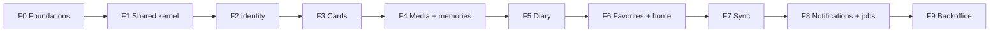

# IMPL-API-001 — Implementation plan: `cherrylove-api`

Purpose: the ordered path from an empty repo to the v1 API, in phases Camilo approves one by one.
Session F (`00-governance/session-prompts/F-plan-api.md`). Nothing here is product code.

Inputs (all `approved`): REQ-DOC-001…004, C4-001, ADR-001…016, DATA-001, API-001, DEC-001…040.

## Quick path

1. Read §1 (version check) and §2 (rules every phase follows).
2. Read §3 (phase order and why).
3. Approve, reject or patch **one phase at a time** (§4…§13), by step ID (e.g. `F2.11 change to …`).
4. Answer the open questions in §14 before the phase they block starts.

Approval states per phase: `draft` → `in_review` → `approved`. Only an approved phase may start.

| Phase | Name | Status |
|-------|------|--------|
| F0 | Foundations (spike, toolchain, stack, CI) | **approved** (Camilo, 2026-11-12) |
| F1 | Shared kernel | **approved** with patches F1.9, F1.12 (Camilo, 2026-11-12) |
| F2 | Identity (membership, invites, auth) | **approved** with patches F2.5, F2.8, F2.12/13, F2.15 and OQ-011 (Camilo, 2026-11-13) |
| F3 | Cards | **approved** with patches F3.2, F3.3, F3.5, integration test, §2 upsert rule and OQ-012 (Camilo, 2026-11-13) |
| F4 | Media + memories (songs, places) | draft |
| F5 | Diary | draft |
| F6 | Favorites + home (+ load generator) | draft |
| F7 | Sync | draft |
| F8 | Notifications + scheduled jobs | draft |
| F9 | Backoffice | draft |

---

## 1. Version re-check (REQ-N-QA-05)

Re-verified on 2026-11-12 against official sources (PyPI JSON API, endoflife.date, Docker Hub API, GitHub
Releases API, npm registry), same method as ADR-016.

### Patch bumps applied by this plan

| Component | ADR-016 pin | New pin | Note |
|-----------|-------------|---------|------|
| `ruff` (dev) | 0.17.4 | **0.17.5** | patch |
| `uv` (CLI) | 0.13.7 | **0.13.8** | patch |

### Unchanged (still the newest patch of the pinned line)

Python 3.14.10 (`python:3.14.10-slim`), Django 5.2.19, `djangorestframework` 3.18.3, `drf-spectacular` 0.30.0,
`djangorestframework-simplejwt` 5.5.1, `argon2-cffi` 25.1.0, `psycopg[binary]` 3.3.9, `cryptography` 50.0.2,
`boto3` 1.44.1, `Pillow` 13.0.0, `redis` 8.1.0, `django-tasks` 0.12.0, `django-tasks-db` 0.13.0, `pywebpush` 2.5.0,
`requests` 2.34.2, Redis 8.8.4 (`redis:8.8.4-alpine`), Mailpit v1.33.1, `oasdiff` v1.37.0.
Dev: `mypy` 2.4.1, `django-stubs` 6.1.2, `djangorestframework-stubs` 3.18.2, `import-linter` 2.16, `pytest` 9.2.0,
`pytest-django` 4.14.0, `pytest-cov` 7.1.0, `hypothesis` 6.170.15, `pip-audit` 2.10.1.

### Watch list (not applied)

| Item | Finding | Action |
|------|---------|--------|
| PostgreSQL | 18.7 released, but `postgres:18.7-alpine` is still not on Docker Hub (HTTP 404) | Stay on 18.6; re-check at F0 start and bump if the image exists (patch) |
| k6 | v2.4.0 is out (pin v2.3.0) | **Minor** bump → needs Camilo's OK; recommended at F6 |
| Redocly CLI | 2.78.0 is out (pin 2.77.0) | **Minor** bump → needs Camilo's OK; recommended at F0 |
| Redis | 8.10 line exists (pin 8.8.4) | Minor line change → not applied |

### Facts checked for later steps

| Fact | Source | Used in |
|------|--------|---------|
| `drf-spectacular` 0.30.0 has `OAS_VERSION` (default `3.0.3`) and emits 3.1 when set to `3.1.0` | drf-spectacular `settings.py`, `plumbing.py` | F0.9 |
| `django-tasks-db` 0.13.0 `compat` extra targets Django `>=5.2,<6.0` + `django-tasks>=0.12.0` | PyPI metadata | F1.13 |
| `django_tasks_db.DatabaseBackend` declares `supports_defer = True` (on `main`) | source on GitHub | F1.14 verifies it on the pinned 0.13.0 |
| MinIO repo archived; maintained S3-compatible candidates: RustFS 1.0.5 (Apache-2.0), SeaweedFS 4.53 (Apache-2.0), Versity S3 Gateway v1.11.0 (Apache-2.0), Garage (AGPL-3.0) | GitHub API | F0.1 spike |

Each later phase starts with the same re-check (5 minutes, no commit unless a patch bump is found).

---

## 2. Rules every phase follows

| Rule | Source |
|------|--------|
| 1 PR per phase, branch `phase/<n>-<slug>`, rebase merge; Camilo approves and merges | DEC-023, ADR-015 §2 |
| 1 commit per step, Conventional Commits, body cites REQ/DEC/ADR IDs | DEC-023, REQ-N-QA-06 |
| ≥ 1 new or changed test per step, marked `@pytest.mark.req("REQ-…")` | DEC-023, ADR-014 §6 |
| ≥ 1 phase integration test against real PostgreSQL/Redis/S3 (never SQLite) | ADR-014 §1 |
| A dependency enters with the **first step that uses it**, at its ADR-016 pin | REQ-N-ARC-06 |
| A step that touches `contract/` is a contract change: Camilo approves it explicitly | ADR-003 §1 |
| No secrets in the repo; `.env.example` only | DEC-039 |
| A gap found mid-phase stops the step and becomes an OQ | CLAUDE.md "never assume" |
| Upsert by client ID: an ID that already exists in **another** couple → `404 not_found` (never a 500 from the PK); the cross-couple harness also sends `PUT` with a foreign ID | ADR-005 §4/§7, REQ-N-SEC-02 |

**Phase "done" (common to all):** green `ci` on the PR; coverage `domain` + `application` ≥ 90 % and overall
≥ 80 % (ADR-014 §7); import-linter green; drift check green; every step's REQ appears in the REQ → tests matrix;
the phase's OWASP ASVS L2 items reviewed (owned by session I, REQ-N-SEC-09).

Step format used below: **ID · commit · test (what it proves) · IDs**.

Learning links: `05-learning/` is still a placeholder (LEARN-001 `not_started`). Each phase lists its concepts;
session D turns them into lessons and adds the links.

---

## 3. Phase order and why

| Order | Why it goes here |
|-------|------------------|
| F0 first | Every later step needs the toolchain, the local stack and a CI that enforces ADR gates from commit one. The S3 spike is step 1 because DEC-037 says so and the Compose file depends on its result. |
| F1 before any module | Every use case needs `Actor`, `UnitOfWork`, `AuditLog`, `ChangeRecorder`, `Cipher`, `JobQueue` (ADR-001 §4–5, ADR-006 §1, ADR-008, ADR-009, ADR-013). Building them once, with fakes, keeps every module's unit tests DB-free. |
| F2 before content | Every couple-owned row has a composite FK to `identity_couple_membership` (DATA-001 §1), and no request has an `Actor` without auth (ADR-005). Also: the custom user model must exist **before the first auth migration** (Django docs: changing `AUTH_USER_MODEL` later is very hard). |
| F3 cards next | Smallest content module that still exercises every kernel piece: encryption, versioned cache, a time-based job, the 404/403/409 table. It proves the pattern before the bigger modules copy it. |
| F4 media + memories | `memories` needs `media` (photo/video/audio) and is the largest module; `media` owns quota across all files (ADR-007 §1). Media comes first inside the phase. |
| F5 diary | Same pattern as cards; adds the `only_me` visibility rule that F6 depends on. |
| F6 favorites + home | Can only star things that exist (memory, song, place, note) and must hide what becomes invisible (REQ-F-FAV-04). All six hot tables exist after F6 → the 1 M-row generator lands here. |
| F7 sync | Push replays the **same use cases** (ADR-006 §2), so every syncable use case must exist first. Change recording itself is already live since F2 (no missed changes from day one). |
| F8 notifications + jobs | Scheduler wires periodic jobs whose use cases already exist (card publish, invite expiry, reservations, tombstones, partitions); push needs cards. |
| F9 backoffice last | Staff UIs are inbound adapters over use cases built earlier (create couple, invites) plus archive/purge, which touch every module. Until F9, a management command creates couples. |

Two placement decisions inside approved shapes (recommendations, approved with the phase):

- `home_get_couple` (`/couple`) is implemented in `identity` (it owns Couple), `home_get_dashboard` (`/home`) in
  `favorites` (ADR-001 §1 gives it REQ-F-HOME-02). The `home` tag and operation IDs stay exactly as in API-001.
- Ports are built in F1 even when their table has an FK to `identity_couple`; the adapter lands in F2. Dependency
  inversion lets us order work by dependency, not by layer.

---

## 4. F0 — Foundations

**Goal:** a repo where every later step is one commit + one test, the local stack runs with one command, and CI
enforces the ADR gates from the first PR. The local S3 server is chosen by evidence.

**REQ covered:** REQ-N-OPS-01, REQ-N-QA-04, REQ-N-QA-05, REQ-N-QA-06, REQ-N-ARC-01, REQ-N-ARC-02, REQ-N-ARC-03,
REQ-N-ARC-06, REQ-N-ARC-09, REQ-N-SEC-06 (spike only). Decisions: DEC-023, DEC-037, DEC-039; ADR-001 §6, ADR-003,
ADR-008 §4, ADR-015, ADR-016.

| ID | Commit | Test (proves) | IDs |
|----|--------|---------------|-----|
| F0.1 | `test(media): add presigned POST acceptance spike for local S3 servers` | `tests/integration/media/test_presigned_post_acceptance.py`, parametrized per candidate (RustFS, SeaweedFS, Versity, Garage) in `spike/compose.s3.yaml`: valid upload accepted; size outside `content-length-range` rejected **by storage**; wrong `Content-Type` rejected; expired policy rejected; signed GET works then expires; bucket CORS limited to one origin; private by default | DEC-037, ADR-007 §2/§7 |
| — | **Stop point** | Results table in the PR. Camilo records **DEC-041** (local S3 server). Criteria: passes every case, not archived, release in the last 6 months, one container, x86 + ARM image. Spike Compose file deleted in F0.4 | DEC-037 |
| F0.2 | `build: pin Python toolchain with uv` | `tests/architecture/test_toolchain.py`: interpreter is 3.14.10; every direct dependency in `uv.lock` equals its pin in `pins.toml` (copy of §1) | ADR-016, REQ-N-QA-05 |
| F0.3 | `chore(django): add Django project skeleton` | `tests/integration/test_settings.py`: `check --deploy` passes on `production.py` with dummy env; settings read only env vars; `/healthz` returns 200 and checks DB | ADR-002 §1, DEC-039 |
| F0.4 | `chore(compose): add local stack` | `tests/integration/test_local_stack.py`: PostgreSQL 18.6, Redis 8.8.4, Mailpit, DEC-041 server reachable; bucket exists and is private; a sent mail appears in Mailpit's API | REQ-N-OPS-01, DEC-041 |
| F0.5 | `feat(shared): add app and maintenance database roles` | `tests/integration/test_db_roles.py`: migrations run as `cherrylove_maintenance`; `cherrylove_app` gets DML through default privileges and is denied DDL | ADR-008 §4, DATA-001 §3 |
| F0.6 | `chore(arch): add import-linter contracts and module skeletons` | `tests/architecture/test_import_contracts.py`: contracts pass; every module has the four layers; a fixture module that imports Django in `domain` is reported | ADR-001 §6, REQ-N-ARC-01 |
| F0.7 | `chore(contract): import approved OpenAPI v1 contract` | `tests/contract/test_contract_file.py`: `contract/openapi.v1.yaml` is byte-identical to API-001; OpenAPI 3.1; operation IDs follow `<tag>_<verb>_<noun>` | ADR-003 §1/§5 |
| F0.8 | `feat(contract): narrow error codes and add examples per endpoint` | Contract test: every 4xx response declares a `code` enum that is a subset of `ErrorCode`; every operation has ≥ 1 example. **Contract change — Camilo approves**; also carries the answers to OQ-007/008 if they change the contract | API-001 `info.description`, ADR-010 §6 |
| F0.9 | `chore(contract): tune drf-spectacular and add drift check` | Unit tests for `scripts/contract_drift.py` (normalization: key order, `$ref` names, enum order); contract test "generated ⊆ approved and equal per implemented operation" per OQ-006. Settings: `OAS_VERSION=3.1.0`, operation-ID hook, enum name overrides, `problem+json` responses, servers `/api/v1` | ADR-003 §2, ⚠️ "plan F budgets one step" |
| F0.10 | `ci: add commit and traceability checks` | Unit tests for `scripts/check_commits.py` (Conventional Commits per commit, IDs in PR body) and `scripts/req_matrix.py` (REQ → tests matrix from `req` markers; unknown marker fails) | REQ-N-QA-06, ADR-014 §6, ADR-015 §1 |
| F0.11 | `ci: add ci workflow` | The workflow itself on this PR: ruff, mypy strict, import-linter, unit, integration (service containers), `makemigrations --check`, drift + `oasdiff breaking`, coverage gates, `pip-audit`, image build; actions pinned by SHA; minimal `permissions`; Dependabot weekly (pip, actions) | ADR-015 §1/§3/§5, REQ-N-QA-04 |
| F0.12 | `build: add api and worker images and publish workflows` | `tests/integration/test_images.py` (CI job): both images start and answer `/healthz`; images run as non-root. Publish to `ghcr.io` on `main`; contract asset `contract-v1.MINOR.PATCH` on merges touching `contract/` | ADR-015 §4, ADR-003 §3 |

**Phase integration test:** `tests/integration/test_phase0_stack.py` — fresh Compose stack, migrate as
maintenance role, `/healthz` OK as app role, one presigned POST round trip against the DEC-041 server.

**Done when:** common criteria (§2) + DEC-041 recorded + `ci` added as the required check on `main` (STATUS.md
note from session R) + contract in `contract/` approved with error enums and examples.

**Recommendations inside this phase (approved with it):**
- `/healthz` outside `/api/v1`, excluded from the schema: operational, not part of the contract.
- `INSTALLED_APPS` in F0–F1 excludes `django.contrib.auth` / `admin`, so no auth table exists before F2.1.

**Concepts:** lockfiles and reproducible builds; 12-factor configuration; least-privilege DB roles; architecture
fitness functions; contract drift; supply-chain hygiene (SHA-pinned actions); a spike as a decision tool.

---

## 5. F1 — Shared kernel

**Goal:** every cross-cutting port with an adapter and an in-memory fake, so modules only write domain + use cases.

**REQ covered:** REQ-N-ARC-01, REQ-N-ARC-05, REQ-N-ARC-09, REQ-N-QA-01, REQ-N-QA-02, REQ-N-SEC-01 (fail-closed
manager), REQ-N-SEC-05 (cipher), REQ-N-SEC-07, REQ-N-PERF-02 (pagination), REQ-N-PERF-04 (cache port),
REQ-F-LOG-01…04, REQ-F-SYNC-03. ADR-001 §3–5, ADR-005 §3, ADR-008, ADR-009, ADR-010, ADR-011, ADR-013 §1–2, ADR-016.

| ID | Commit | Test (proves) | IDs |
|----|--------|---------------|-----|
| F1.1 | `feat(shared): add ids, clock and base domain errors` | Hypothesis: UUIDv7 VO accepts only version 7 and timestamps ≤ 24 h ahead (stdlib `uuid.uuid7()`); `FixedClock` fake; each error class has `code`, `status`, `params` | REQ-F-SYNC-03, ADR-006 §8, ADR-010 §3 |
| F1.2 | `feat(shared): add Actor and actor resolver port` | Unit: `Actor` is immutable and built only from a resolver (no constructor from request data) | ADR-005 §1, REQ-N-SEC-01 |
| F1.3 | `feat(shared): add unit of work port and Django adapter` | Unit with fake; integration: exception inside the UoW leaves no row | ADR-001 §5 |
| F1.4 | `feat(shared): add after-commit event bus` | Integration: handler runs after commit, never after rollback | ADR-001 §3–4 |
| F1.5 | `feat(shared): add ChangeRecorder port` | Unit: in-memory fake records `(couple, type, id, author)` in call order; adapter lands in F2.3 | ADR-006 §1 |
| F1.6 | `feat(shared): add fail-closed couple-scoped manager` | Integration: default queryset raises; `for_couple()` filters; architecture test fails if `unscoped` appears outside `backoffice/infrastructure/` | ADR-005 §3, REQ-N-SEC-01 |
| F1.7 | `feat(shared): add RFC 9457 problem details handler` | Unit per mapping (domain, DRF `ValidationError`, `Throttled`, `Http404`, unknown → 500 with no internals); `errors[].pointer` is JSON Pointer | ADR-010, REQ-N-QA-02 |
| F1.8 | `feat(shared): add request id middleware and JSON logging` | `X-Request-ID` accepted (≤ 64, safe charset) or generated, echoed, present in log lines and problem bodies | REQ-N-QA-01, ADR-008 §7 |
| F1.9 | `feat(shared): add security headers, CSP and CORS middleware` | HSTS, `nosniff`, `Referrer-Policy`, `frame-ancestors 'none'`, CSP for JSON responses (Django Admin CSP is tested in F9.1, once the admin is installed); `Cache-Control: no-store` on authenticated responses; CORS: only the web origin, with credentials; other origins get no `Access-Control-Allow-*` | ADR-016 §1, REQ-N-SEC-07, ADR-004 §2, ADR-011 §3 |
| F1.10 | `feat(shared): add cursor pagination` | Unit: opaque cursor round trip; tampered cursor → 400; limit 1–500, default 50; shape `{results, next_cursor}` | REQ-N-PERF-02, ADR-003 §5 |
| F1.11 | `feat(audit): add partitioned audit_event table` | Integration: monthly partitions (current + 3 ahead) by raw-SQL migration; app role `UPDATE` → permission denied; maintenance `UPDATE` → trigger raises; per-partition indexes exist | REQ-F-LOG-03/04, ADR-008 §1/§4/§5 |
| F1.12 | `feat(audit): add AuditLog port with field classification` | Unit: diff keeps values only for loggable fields, `{changed: true}` for content; failed-login email stored as HMAC with its own key `AUDIT_HMAC_KEY` (env only, listed in `.env.example`, ≠ KEK and `SECRET_KEY`; empty key rejected at startup); architecture test: every registered entity field is classified. Integration: in-transaction write commits with the change; rejected attempt written after rollback | REQ-F-LOG-01/02, ADR-008 §2/§3 |
| F1.13 | `feat(shared): add AES-GCM envelope cipher` | Unit: round trip; AAD swap (other row/field/couple) fails; tampered byte fails; KEK re-wrap keeps values readable; format `version | key_id | nonce | ct`. DEK store is a port (fake now, table in F2.4) | REQ-N-SEC-05, ADR-009 §1–3/§6 |
| F1.14 | `feat(shared): add cache port with fail-open Redis adapter` | Integration: hit/miss; Redis unreachable → value computed and a warning logged; 24 h safety TTL | ADR-011 §1–2, REQ-N-PERF-04 |
| F1.15 | `feat(shared): add job queue port on django-tasks-db` | Integration: job row rolls back with the transaction; same idempotency key twice → one execution; `default` and `media` queues | ADR-013 §1–2, ADR-016 §1 |
| F1.16 | `test(shared): verify deferred execution of the database task backend` | Integration with real `db_worker`: a task with `run_after` is not picked before its time, then runs. **If it fails → stop, OQ, fallback: `next_attempt_at` in `shared_job_execution` re-enqueued by the scheduler** | ADR-013 §2 ("verified in plan F") |
| F1.17 | `feat(shared): add job retry wrapper with backoff` | Unit with `FixedClock`: delays 1 min → 4 h, max 6 attempts; integration: 6th failure marks `failed` and writes `job.failed` audit | ADR-013 §2 |

**Phase integration test:** `tests/integration/shared/test_kernel_transaction.py` — a test-only probe use case
writes audit + job + recorded change in one UoW; on error nothing persists and the response is Problem Details
with the request's `request_id`; on success all three exist.

**Done when:** common criteria + every port has a fake in `tests/fakes/` + shared coverage ≥ 90 %.

**Recommendation inside this phase:** CORS as an own ~30-line middleware instead of `django-cors-headers`, same
reasoning ADR-016 used for CSP (no new dependency, REQ-N-ARC-06).

**Concepts:** ports and adapters; Unit of Work; why audit and jobs are transactional but events are not; AEAD and
envelope encryption; RFC 9457; fail-open vs fail-closed; append-only enforced by the database; range partitioning.

---

## 6. F2 — Identity (membership, invites, auth)

**Goal:** an admin creates a couple; both partners onboard by invite; sessions work for web and mobile with
rotation, reuse detection and revocation; every request has a server-resolved `Actor`.

**REQ covered:** REQ-F-AUTH-01…10, REQ-F-ACC-02, REQ-F-ACC-03, REQ-F-ACC-04, REQ-F-ACC-06, REQ-F-HOME-01 (header
data), REQ-F-ADM-01/02 (use cases only), REQ-N-SEC-01…04, REQ-F-LOG-01 (auth events). ADR-004, ADR-005, ADR-006 §1,
ADR-009 §1, ADR-011 §1, ADR-012 §4, DATA-001 §3.

| ID | Commit | Test (proves) | IDs |
|----|--------|---------------|-----|
| F2.1 | `feat(identity): add custom user model` | Integration: `AUTH_USER_MODEL = identity.User` in the first identity migration; unique `lower(email)`; Argon2 first hasher (`argon2-cffi` enters) | ADR-004 §4, DATA-001 §3 |
| F2.2 | `feat(identity): add couple and membership constraints` | Integration: 3rd member → `IntegrityError`; user in a 2nd couple → `IntegrityError`; `UPDATE couple_id` → trigger error; staff user as member → trigger error | REQ-F-AUTH-05, DATA-001 §3 |
| F2.3 | `feat(sync): add ChangeRecorder adapter on sync_state` | Integration: two concurrent writers of one couple get consecutive `seq` and commit order = `seq` order; `sync_entity_index` upserts one row per entity | ADR-006 §1, REQ-F-SYNC-06 |
| F2.4 | `feat(shared): add couple data key store` | Integration: DEK created with the couple, stored wrapped; raw SQL shows no plaintext key | ADR-009 §1, DATA-001 §5 |
| F2.5 | `feat(identity): add create couple use case and command` | Unit with fakes; integration: couple + `sync_state` + DEK + two invites + two invite-email jobs + `admin.couple_created` audit in one transaction; email already in a couple → `email_already_in_couple`. Inbound adapter: `manage.py create_couple` until F9, run as actor `system` (no staff exists yet); `sync_state` created through `sync/application/public.py`, never sync infrastructure (ADR-001 §3) | REQ-F-AUTH-01, REQ-F-AUTH-10, REQ-F-ADM-01 |
| F2.6 | `feat(identity): add invite issue, resend and revoke` | Unit: 32-byte token, only SHA-256 stored, 72 h; resend revokes the old token and issues a new one; one pending invite per seat (partial unique) | REQ-F-AUTH-02, REQ-F-ADM-02, DEC-017 |
| F2.7 | `feat(identity): add bilingual invite email job` | Integration: Mailpit receives one email, Spanish first then English; re-running the job sends nothing (idempotency key) | ADR-012 §4, ADR-013 §2/§5 |
| F2.8 | `feat(identity): add get and accept invite endpoints` | `identity_get_invite`, `identity_accept_invite`: expired → `invite_expired`; revoked → `invite_revoked`; full → `couple_full`; archived → `couple_archived`; second partner is not asked relationship start; first partner can use the app alone; throttle 10/h per IP; the returned session follows `X-CherryLove-Client` (web: refresh only in the `cl_refresh` cookie, never in the body; mobile: in the body) | REQ-F-AUTH-02…06, REQ-F-AUTH-10, DEC-018 |
| F2.9 | `feat(identity): add JWT token issuer adapter` | Unit: access 10 min, refresh 30 days, HS256 with a key ≠ `SECRET_KEY`, claims only `sub/exp/iat/jti` (no `couple_id`) — `djangorestframework-simplejwt` + blacklist app enter | ADR-004 §1 |
| F2.10 | `feat(identity): add login, refresh and logout endpoints` | Web: refresh only in `cl_refresh` cookie (`HttpOnly; Secure; SameSite=Strict; Path=/api/v1/auth/`), never in body; cookie calls without `X-CherryLove-Client: web` → 403; mobile: pair in body; every attempt audited | REQ-F-AUTH-07, REQ-F-ACC-06, REQ-N-SEC-03, ADR-004 §2/§6 |
| F2.11 | `feat(identity): add refresh token reuse detection` | Replaying a rotated refresh → 401, **all** the user's refresh tokens revoked, `auth.refresh_reused` audit | ADR-004 §3, ADR-014 §5 |
| F2.12 | `feat(identity): add auth throttles that fail closed` | Login 5/min per IP+email; Redis down → 503 `service_unavailable` on auth scopes only (the recovery scope is tested in F2.13, where its endpoint exists) | REQ-N-SEC-04, ADR-004 §4, ADR-011 §2 |
| F2.13 | `feat(identity): add password recovery` | Same status and body whether the email exists or not; token valid 30 min, dead after password change; email in the account's language; throttle 3/h per email, failing closed | REQ-F-AUTH-08, ADR-004 §4, ADR-012 §4 |
| F2.14 | `feat(identity): add actor resolution with cached membership` | `IsCouplePartner`: active user, has couple, couple active; cached `actor:{user_id}` 10 min; actor never read from URL/body/header | ADR-005 §1, ADR-011 §1, REQ-N-SEC-01 |
| F2.15 | `feat(identity): add deactivate user with actor cache invalidation` | New use case `deactivate_user` (REQ-F-ADM-01, reused by F9.2) revokes refresh tokens and deletes the key; the next request with a still-valid access token is rejected at once (not after 10 min); the same hook is called by F9.4 | ADR-005 consequence, REQ-F-AUTH-09 |
| F2.16 | `feat(identity): add me, couple header and change password` | `identity_get_me`/`update_me` (name, language; birth date read-only); `home_get_couple`; `identity_change_password` needs the current password and revokes every other session; how the current session is identified follows OQ-011 | REQ-F-ACC-02/03/04, REQ-F-HOME-01, DEC-025 |
| F2.17 | `test(identity): add generated cross-couple suite and identity matrix rows` | Harness walks the URL conf; every route with an ID parameter needs a resource factory or the test fails; couple B's token on couple A's ID → 404. Permission-matrix rows for onboarding | ADR-005 §7, ADR-014 §5, REQ-N-SEC-02 |

**Phase integration test:** `tests/integration/identity/test_onboarding_journey.py` — `create_couple` → invite in
Mailpit → partner 1 accepts (sets relationship start) and logs in on web → partner 2 accepts (not asked) and logs in
on mobile → `/couple` shows both → refresh rotates → reused refresh kills all sessions → audit rows for every step.

**Done when:** common criteria + all REQ-F-AUTH-* have tests + cross-couple harness active.

**Concepts:** custom user model timing; invariants as DB constraints and triggers; token rotation and theft
detection; CSRF with `SameSite` + custom header; throttling; cache invalidation; server-side i18n with gettext.

---

## 7. F3 — Cards

**Goal:** daily cards end to end: schedule, lock on publish, today/random-past screen, my cards, pending counter.

**REQ covered:** REQ-F-CARD-01…07 (CARD-08 through the same use cases in F7), REQ-N-SEC-05, REQ-N-PERF-02,
REQ-N-PERF-03, REQ-N-PERF-04, REQ-F-SYNC-05 (columns). ADR-005 §4, ADR-006 §1, ADR-009, ADR-011, ADR-014 §4.

| ID | Commit | Test (proves) | IDs |
|----|--------|---------------|-----|
| F3.1 | `feat(cards): add card entity and policies` | Unit: edit/delete only by author (`not_author` 403) and only before publish (`card_already_published` 409); partner's scheduled card invisible | REQ-F-CARD-05/06/07, ADR-005 §4 |
| F3.2 | `feat(cards): add card table with encrypted body` | Integration: `body_enc` holds no plaintext; trigger rejects body/`publish_at` change **and setting `deleted_at`** after publish (hard purge by the maintenance role unaffected); composite FK to membership; indexes from DATA-001 | REQ-N-SEC-05, DATA-001 §4 |
| F3.3 | `feat(cards): add upsert and delete use cases and endpoints` | `cards_upsert_card` (client UUIDv7, `version` + 1, optional `base_version` kept for F7), `cards_delete_card` (tombstone); change recorded and audited in the same transaction; an ID owned by another couple → 404; `publish_at` already past follows OQ-012 | REQ-F-CARD-05/07, REQ-F-SYNC-03/05 |
| F3.4 | `feat(cards): add publish due cards use case` | `FixedClock`: due cards get `published_at`, a change per card, idempotent on rerun; run by `manage.py publish_due_cards` until the F8 scheduler | REQ-F-CARD-06, ADR-006 §1, ADR-013 §3 |
| F3.5 | `feat(cards): add today query with deterministic past card` | "Published today" = civil date of `published_at` in the couple timezone (test zone **with DST**); carousel order identical for both partners; no card today → same random past card for both (seed = couple + civil date, seeded port); cache key `cards:today:{couple}:{date}:{seq}` holds IDs only; Redis down → same answer | REQ-F-CARD-01/02/03/04, ADR-011 §1, ADR-014 §4 |
| F3.6 | `feat(cards): add my cards, get card and pending count` | `cards_list_mine` cursor-paginated with a fixed query count (`django_assert_num_queries`); partner's scheduled card → 404; `cards_get_pending_count` returns a number only | REQ-F-CARD-05/06, REQ-N-PERF-02, DEC-007 |
| F3.7 | `test(cards): add permission matrix and cross-couple factories` | Matrix rows for cards; cross-couple harness now covers every card route | ADR-005 §7 |
| F3.8 | `test(cards): verify card query plans` | Integration: `EXPLAIN (FORMAT JSON)` on today, mine and the publish query uses the DATA-001 indexes (small seed; 1 M-row run in F6) | REQ-N-PERF-03 |

**Phase integration test:** partner A schedules a card for tomorrow → B sees counter 1 and 404 on its ID → clock
moves → publish → B's today shows it → A's edit returns 409 → audit has create and publish events, plus view events per OQ-007 (at least the
server-observed `GET`).

**Done when:** common criteria.

**Concepts:** aggregate invariants; encryption confined to mappers; civil dates vs instants (DST); deterministic
randomness; versioned cache keys instead of invalidation.

---

## 8. F4 — Media + memories (songs, places)

**Goal:** files go client → storage directly, are validated in quarantine, counted against the quota; memories link
media, one song and one place; songs and places work as first-class entities.

**REQ covered:** REQ-F-MEM-07…10 (server side of MEM-01…06), REQ-F-SONG-01…08, REQ-F-PLACE-01…05, REQ-F-ACC-01,
REQ-F-ADM-05 (defaults), REQ-F-SYNC-07, REQ-N-SEC-06, REQ-N-PERF-05, REQ-N-LEG-01. DEC-009, DEC-010, DEC-012, DEC-020;
ADR-007, ADR-009 §4, DATA-001 §4–5.

| ID | Commit | Test (proves) | IDs |
|----|--------|---------------|-----|
| F4.1 | `feat(media): add object storage port with S3 adapter` | F0.1 acceptance cases become the adapter's integration tests (`boto3` enters): presigned POST 15 min with size and type pinned; signed GET 10 min; keys `quarantine/{couple}/{media}` and `media/{couple}/{media}/{variant}` | ADR-007 §2/§5/§7 |
| F4.2 | `feat(backoffice): add settings with quota defaults` | Integration: `backoffice_setting` seeded with 5 GB, 20/200/30 MB, audit retention 12 months; read through `backoffice/application/public.py` (staff UI in F9) | REQ-F-ADM-05, DEC-020, ADR-008 §5 |
| F4.3 | `feat(media): add asset and quota reservation under row lock` | Integration: 20 parallel reservations never exceed the limit; `media_storage` created on first use | REQ-F-MEM-10, ADR-007 §4, ADR-014 §5 |
| F4.4 | `feat(media): add create upload and complete endpoints` | `media_create_upload` (`file_too_large`, `quota_exceeded`), `media_complete_upload` enqueues validation on queue `media` inside the transaction | REQ-F-MEM-09/10, REQ-F-SYNC-07 |
| F4.5 | `feat(media): add photo and avatar validation with Pillow` | Worker: real decode; declared type must match; EXIF (GPS) stripped; `thumb_400`, `display_1600`, `avatar_256` WebP; `Cache-Control: private, max-age=31536000, immutable`; quota moves reserved → used; a renamed text file → `rejected`, object deleted, reservation released (`Pillow` enters) | REQ-N-SEC-06, REQ-N-PERF-05, ADR-007 §3, ADR-011 §3 |
| F4.6 | `feat(media): add video and audio validation with ffprobe` | Worker image adds Debian `ffmpeg`; MP4/MOV/MP3/M4A probed; `poster_800.webp`; fake container rejected | ADR-007 §3/§8 |
| F4.7 | `feat(media): add signed URL batch and asset status endpoints` | `media_create_signed_urls` for N IDs in a fixed query count; other couple's IDs → not returned; `media_get_asset` shows status and rejection code; status change reaches the device per OQ-008 | ADR-007 §5, REQ-N-PERF-02, REQ-F-SYNC-10 |
| F4.8 | `feat(media): add stale reservation release and object deletion` | Use cases (scheduled in F8): reservation older than 1 h released; deleting an entity enqueues object deletion in the transaction and lowers `used_bytes` | ADR-007 §4 |
| F4.9 | `feat(memories): add places` | Upsert/delete/list (memory counts)/get; `description_enc`; coordinate checks; deleting a place clears `place_id` of its memories in the same use case | REQ-F-PLACE-01/02/03/05, ADR-009 §4 |
| F4.10 | `feat(memories): add songs with source union` | `SongSource` = `upload | audio_url | spotify | youtube`; Spotify/YouTube URLs parsed server-side to `provider_ref`; `https` only; upload needs a ready `audio` asset of the same couple; `note_enc`; DB `CHECK` per source | REQ-F-SONG-02/05/06/08, REQ-N-LEG-01, ADR-007 §6 |
| F4.11 | `feat(memories): add memories with song and place links` | Exactly one of `media_id` / `external_url`; media must be a ready photo/video of the couple; song 0..1, place 0..1 via composite FKs; edit own only; gallery order `(memory_date, id)` with cursor; management list | REQ-F-MEM-07/08, REQ-F-SONG-07, DEC-012 |
| F4.12 | `feat(memories): edit song–memory relation from the song side` | Same column `memory.song_id` updated from either side; rule for partner's memories per OQ-009; song detail lists related memories in one query | REQ-F-SONG-03/06/07 |
| F4.13 | `feat(identity): accept avatar media on profile update` | `update_me` accepts only a ready `avatar` asset owned by the user | REQ-F-ACC-01 |
| F4.14 | `test(memories): add matrix, cross-couple factories and gallery plan` | Matrix rows for memories/songs/places/media; cross-couple harness covers every route; gallery `EXPLAIN` uses `(couple_id, memory_date, id)` | ADR-005 §7, REQ-N-PERF-03 |

**Phase integration test:** upload a photo by presigned POST → complete → worker → variants ready → memory created
with a Spotify song and a new place → partner lists the gallery and gets signed URLs in one call → oversize upload
refused by storage → fake JPEG rejected by the worker → quota counters exact → deleting the place unlinks the memory.

**Done when:** common criteria + worker image builds with ffmpeg + API image does not contain it.

**Concepts:** presigned POST policies; quarantine pattern; pessimistic row locks; discriminated unions; consistency
boundaries (why Song and Place live in `memories`); metadata privacy (EXIF).

---

## 9. F5 — Diary

**Goal:** notes with `shared` / `only_me` visibility, encrypted, own-only edits.

**REQ covered:** REQ-F-NOTE-01…05, REQ-N-SEC-05, REQ-F-FAV-04 (event source). DEC-014, ADR-005 §4, ADR-009.

| ID | Commit | Test (proves) | IDs |
|----|--------|---------------|-----|
| F5.1 | `feat(diary): add note entity and visibility policies` | Unit: partner's `only_me` note is invisible (repository returns `None` → 404); edit own only | REQ-F-NOTE-02/05, DEC-014 |
| F5.2 | `feat(diary): add note table with encrypted body` | Integration: `body_enc` no plaintext; partial index for `only_me` | REQ-N-SEC-05, DATA-001 §4 |
| F5.3 | `feat(diary): add note upsert and delete with visibility event` | Change recorded + audited; `NoteVisibilityChanged` / `NoteDeleted` published after commit | REQ-F-NOTE-01/05, ADR-001 §3 |
| F5.4 | `feat(diary): add list and get note endpoints` | List shows author and `created_at`, excludes partner's `only_me`, fixed query count; get → 404 for partner's `only_me` | REQ-F-NOTE-03, REQ-N-PERF-02 |
| F5.5 | `test(diary): add matrix rows and cross-couple factories` | "Read `only_me` note" matrix row; harness covers note routes | ADR-005 §7 |

**Phase integration test:** A writes `only_me` → B's list and get never show it → A switches to `shared` → B sees it
→ audit has create, update and view events.

**Done when:** common criteria.

**Concepts:** "invisible = not found" as one code path; events as the seam for cross-module reactions.

---

## 10. F6 — Favorites + home (+ load generator)

**Goal:** personal stars on four item types, the home timeline of both partners, and the 1 M-row performance check.

**REQ covered:** REQ-F-FAV-01…04, REQ-F-HOME-01…04 (API side), REQ-F-MEM-06, REQ-F-SONG-04, REQ-F-PLACE-04,
REQ-F-NOTE-04, REQ-N-PERF-01, REQ-N-PERF-03, REQ-N-PERF-04, REQ-N-PERF-06. DEC-011, DEC-034, ADR-001 §3, ADR-011,
ADR-014 §1.

| ID | Commit | Test (proves) | IDs |
|----|--------|---------------|-----|
| F6.1 | `feat(memories): add batched visibility facade` | `get_visible_items(actor, ids)` for memories, songs, places in ≤ 1 query per type | ADR-001 ⚠️ (batched facades) |
| F6.2 | `feat(diary): add batched visibility facade` | Same for notes; partner's `only_me` never returned | REQ-F-FAV-04 |
| F6.3 | `feat(favorites): add star and unstar` | `favorites_star_item` / `favorites_unstar_item`: only visible items (else 404); duplicate → `already_favorited` 409; partial unique; composite FK on `(couple_id, user_id)` | REQ-F-MEM-06, REQ-F-SONG-04, REQ-F-PLACE-04, REQ-F-NOTE-04 |
| F6.4 | `feat(favorites): add my favorites list with type filter` | `favorites_list_mine`: filter by type, memories carry `memory_date` for grouping, cursor, fixed query count | REQ-F-FAV-01/02/03 |
| F6.5 | `feat(favorites): hide favorites of deleted or private items` | Read-time visibility filter is the guarantee; event handler tombstones the partner's favorite and records a change so devices drop it; test both, including a lost event | REQ-F-FAV-04, ADR-001 §4 |
| F6.6 | `feat(favorites): add home dashboard` | `home_get_dashboard`: header via identity facade + both partners' favorites with `starred_by`, ordered by date; cache `home:{couple}:{seq}` holds refs only; batched hydration | REQ-F-HOME-01/02/03, ADR-011 §1 |
| F6.7 | `feat(shared): add load-data generator` | `manage.py seed_load` (refuses outside local settings): 1 M rows each in `memories_memory`, `cards_card`, `diary_note`, `favorites_favorite`, `audit_event`, `sync_entity_index`, spread over many couples, real encryption, `COPY`-based; integration test with a small N checks counts and constraints | REQ-N-PERF-06, DEC-034, DATA-001 §6 |
| F6.8 | `perf: add k6 scripts and query plan report` | `perf/k6/{today,home,lists}.js` with threshold p95 < 200 ms, cache on and off; `perf/explain.py` stores `EXPLAIN ANALYZE` at 1 M rows; `tests/perf/` (marker `perf`, local/nightly) asserts index scans | REQ-N-PERF-01/03, ADR-011 §6, ADR-014 §1 |

**Phase integration test:** both partners star items → home shows both with `starred_by` → B turns a note
`only_me` → it leaves A's favorites and home → cache keys change with `seq`.

**Done when:** common criteria + k6 report attached to the PR (today, home, lists under p95 200 ms at 1 M rows) +
cache on/off result recorded (a cache that does not move p95 is proposed for removal, ADR-011 §6).

**Concepts:** composition through facades; N+1 across module borders; read-time correctness vs event-driven
cleanup; load testing; reading `EXPLAIN ANALYZE`.

---

## 11. F7 — Sync

**Goal:** offline devices push queued operations idempotently and pull every change they may see, never more.

**REQ covered:** REQ-F-SYNC-01…10 (server side), REQ-F-CARD-08, REQ-F-NOTE-02, REQ-F-FAV-04, REQ-N-PERF-02.
ADR-005 §6, ADR-006, ADR-010 §4, ADR-014 §1/§5.

| ID | Commit | Test (proves) | IDs |
|----|--------|---------------|-----|
| F7.1 | `feat(sync): add client operation store` | Same `client_op_id` twice → stored result returned, use case not run again | REQ-F-SYNC-04 |
| F7.2 | `feat(sync): add push endpoint` | `sync_push_operations`: ≤ 100 ordered ops dispatched to the same use cases with the same `Actor`; results `applied` / `rejected` (embedded Problem) / `gone`; later ops on a rejected entity rejected; other couple's entity → rejected as not found without aborting the batch; one audit per op + `sync.pushed` | REQ-F-SYNC-02/04/10, ADR-006 §2, ADR-005 §6 |
| F7.3 | `feat(sync): add last-write-wins with tombstones` | Older `base_version` still applies with `overwrote_newer: true` (result + audit); update after delete → `gone` | REQ-F-SYNC-05, ADR-006 §3 |
| F7.4 | `feat(sync): add pull endpoint` | `sync_pull_changes`: opaque `seq` cursor, ≤ 500, batched facade loads per type; invisible → `delete`; `pending_card_count`; cursor older than `purged_through_seq` → 410 `cursor_expired` | REQ-F-SYNC-06, ADR-006 §4 |
| F7.5 | `feat(identity): record couple header changes for sync` | Name or relationship-start change bumps `seq`; pull returns entity type `couple` | ADR-006 §7 |
| F7.6 | `feat(sync): add tombstone and client operation purge` | Use cases (scheduled in F8): tombstones > 90 days hard-deleted and `purged_through_seq` advanced; client ops > 30 days deleted | ADR-006 §1/§5 |
| F7.7 | `test(sync): add property-based sync invariants` | Hypothesis: replay idempotency; cursor never skips under concurrent writers; deletes win; invisible → delete | ADR-014 §1/§5 |
| F7.8 | `perf: add k6 pull script` | Pull at 1 M `sync_entity_index` rows under p95 200 ms (no media) | REQ-N-PERF-01/06 |

**Phase integration test:** A edits one memory on two offline devices → both push → LWW with `overwrote_newer` →
B pulls the winner → A replays a batch → identical stored results → A's `only_me` note never reaches B → a card
published by the job reaches B's next pull.

**Done when:** common criteria + property tests in CI.

**Concepts:** why a per-couple serialized counter beats timestamps; idempotency keys; LWW and its honest
limits; property-based testing.

---

## 12. F8 — Notifications + scheduled jobs

**Goal:** the scheduler runs every periodic job exactly once per slot; pushes reach the right partner, in their
language, with no private content.

**REQ covered:** REQ-F-NOTIF-01…05, REQ-F-ACC-05, REQ-F-AUTH-02 (expiry job), REQ-F-LOG-04 (partition job),
DEC-026, DEC-036, ADR-008 §5, ADR-012 §4, ADR-013.

| ID | Commit | Test (proves) | IDs |
|----|--------|---------------|-----|
| F8.1 | `feat(shared): add scheduler with slot keys` | Two schedulers ticking together enqueue each slot once (`shared_scheduler_slot` unique) | ADR-013 §3 |
| F8.2 | `feat(identity): add invite expiry job` | Pending invites older than 72 h → `expired` | REQ-F-AUTH-02, DEC-017 |
| F8.3 | `feat(audit): add partition maintenance job` | `FixedClock`: keeps 3 future months; detaches and drops partitions older than the retention setting; runs on the maintenance DB alias | REQ-F-LOG-04, ADR-008 §5 |
| F8.4 | `feat(shared): schedule periodic jobs` | Registry: publish cards (1 min), invite expiry and stale reservations (hourly), tombstones, client ops, partitions (daily); Compose gains `worker-default`, `worker-media`, `scheduler` | ADR-013 §1/§3 |
| F8.5 | `feat(notifications): add devices and preferences` | `notifications_register_device`, `notifications_delete_device`, `notifications_get_preferences`, `notifications_update_preferences`; no row = enabled | REQ-F-NOTIF-04, REQ-F-ACC-05, ADR-013 §4/§5 |
| F8.6 | `feat(notifications): add Expo push adapter and receipts` | Fake Expo endpoint: send, receipts job every 15 min, `DeviceNotRegistered` deletes the token (`requests` enters) | REQ-F-NOTIF-03, ADR-013 §4 |
| F8.7 | `feat(notifications): add Web Push adapter` | VAPID from env; 404/410 deletes the subscription (`pywebpush` enters) | REQ-F-NOTIF-03 |
| F8.8 | `feat(notifications): send card published push` | Publish enqueues one job per recipient in the same transaction (`push:card_published:{card}:{user}`); preference checked at run time; gettext text in the recipient's language; payload `{type, card_id}` only — test asserts the body is absent | REQ-F-NOTIF-01/04/05, ADR-012 §4 |
| F8.9 | `feat(notifications): add anniversary and birthday reminders` | Hourly tick sends at 09:00 couple time, yearly (DEC-036), anniversary to both, birthday to the other partner; 29 Feb rule per OQ-010 | REQ-F-NOTIF-02, DEC-036 |

**Phase integration test:** a card is published → one push job per recipient → fake Expo receives a payload without
the body, in the recipient's language → toggling the preference off before the job runs prevents the send → running
the job twice sends once.

**Done when:** common criteria + all three worker processes run in Compose.

**Concepts:** transactional job enqueue; idempotency keys vs slot keys; push delivery and receipts; checking
preferences at execution time.

---

## 13. F9 — Backoffice

**Goal:** staff run the platform through Django Admin and custom views, see metadata only, and can archive and purge
a couple for real.

**REQ covered:** REQ-F-ADM-01…10, REQ-F-AUTH-01/02/09 (staff side), REQ-F-LOG-01 (admin actions), REQ-N-SEC-08.
DEC-005, DEC-015, DEC-016, DEC-019, DEC-025; ADR-005 §5, ADR-008 §6, ADR-009 §5, DATA-001 §7. Blocked in part by
OQ-002, OQ-005, OQ-007.

| ID | Commit | Test (proves) | IDs |
|----|--------|---------------|-----|
| F9.1 | `feat(backoffice): add staff roles` | Migration creates groups `support` (view metadata), `admin` (+ change Couple, Invite, quotas, birth date), `superadmin` (`is_superuser`); a matrix test per staff row; staff login audited and throttled; Django Admin pages served with their own CSP (moved from F1.9); staff 2FA step added here **only if OQ-002 is accepted** | REQ-F-ADM-08, DEC-016, ADR-005 §5 |
| F9.2 | `feat(backoffice): add couple, user and invite admin` | Admin actions call existing use cases (create couple, resend/revoke invite, correct birth date, set timezone); architecture test: Card, Memory, Song, Place, Note are **not** registered | REQ-F-ADM-01/02/04/09, REQ-N-SEC-08 |
| F9.3 | `feat(backoffice): add quotas and settings admin` | Changing a quota is audited and applies to the next reservation; per-couple override | REQ-F-ADM-05 |
| F9.4 | `feat(identity): add archive couple use case` | Accounts disabled, refresh tokens revoked, actor cache deleted (F2.15), `purge_after = +90 d`, audited; login → `couple_archived` | REQ-F-ADM-03, REQ-F-AUTH-09, DEC-019 |
| F9.5 | `feat(backoffice): add archived couple purge job` | Maintenance role, DATA-001 §7 order, media prefix deleted, DEK deleted; a ciphertext copied before purge cannot be decrypted afterwards; audit rows remain | DEC-019, ADR-009 §5, ADR-014 §5 |
| F9.6 | `feat(backoffice): add export before purge` | Shape per OQ-005 | REQ-F-ADM-03 |
| F9.7 | `feat(backoffice): add metric rollups and dashboard` | Daily/weekly/monthly rollups from audit into `backoffice_metric_rollup`; the dashboard never scans raw audit; "items visited" per OQ-007 | REQ-F-ADM-06, ADR-008 §6 |
| F9.8 | `feat(backoffice): add audit log viewer` | Filters type, date, couple, user; date range required and ≤ 31 days; `EXPLAIN` touches ≤ 2 partitions | REQ-F-ADM-07, ADR-008 §6 |
| F9.9 | `test(backoffice): close contract and requirement coverage` | Drift check has no pending operations left; REQ matrix shows a test for every API-side frozen REQ | ADR-003 §2, ADR-014 §6 |

**Phase integration test:** superadmin creates an admin and a support user → support sees metrics but cannot change
anything → admin creates a couple from the admin and archives it → partners cannot log in → clock + 90 days → purge →
no rows, no objects, no DEK, audit kept.

**Done when:** common criteria + the v1 API answers every API-001 operation + REQ matrix complete.

**Concepts:** admin as just another inbound adapter; RBAC with Django groups; crypto-shredding; rollups vs raw
scans; partition pruning.

---

## 14. Open questions raised by this plan

Recorded in `02-requirements/open-questions.md` with recommendations. Each blocks only the step listed.

| OQ | Topic | Blocks |
|----|-------|--------|
| OQ-002 (existing) | Staff 2FA | part of F9.1 |
| OQ-005 | Export for an archived couple whose partners cannot log in | F9.6 |
| OQ-006 | Drift check while endpoints are implemented phase by phase | F0.9 |
| OQ-007 | "View" events and "items visited" when clients read from the local store | F0.8, F3, F9.7 |
| OQ-008 | How a media status change reaches the device (no `media` sync entity type in API-001) | F0.8, F4.7 |
| OQ-009 | May the song form link the partner's memories? | F4.12 |
| OQ-010 | Reminders for a 29 February date in non-leap years | F8.9 |
| OQ-011 | Change password cannot tell which session is the current one | F2.16 |
| OQ-012 | A card created or edited with a `publish_at` already in the past | F3.3 |

## Next step

Camilo reviews F0 first. On `F0 approved`, its status changes here and in `STATUS.md` (IMPL-API-001), and the F0
branch starts in `cherrylove-api` with step F0.1.
